# Relit

**A new renderer for the original Doom engine.**

Relit keeps Doom's original engine running the game, every rule, monster and door exactly as it was, and replaces everything you *see* with a new real-time 3D renderer. Press **V** at any moment to flip between 1993 and now.

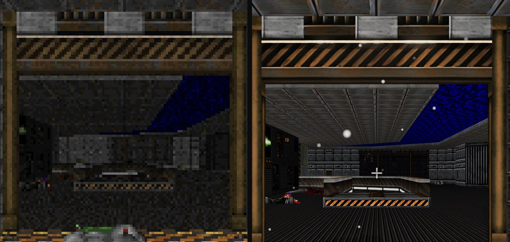

<p align="center"><sub>The same doorway, same moment, zoomed in. Left: the 1993 renderer. Right: Relit. One key flips between them.</sub></p>

> 🆕 **New: Wrecklight, car combat on Doom's engine. Pick a car, arm it with a roof gun and rockets, and race a lava track full of demons.** [See Wrecklight ↓](#bonus-level-wrecklight-car-combat)
>
> 🆕 **New: play all eight levels of Quake's first episode on Doom's 1993 engine, from the Slipgate Complex to Chthon.** [See the Quake episode ↓](#bonus-episode-quake-episode-1)
>
> 🆕 **New: a Quake III-style arena from OpenArena, packed with Doom II's toughest monsters.** [See the arena ↓](#bonus-level-openarena-the-other-side)

---

## Play in 30 seconds

Everything you need is in this repo, including a free game to play.

1. **Get it:** `git clone https://github.com/shouvik12/relit.git`, or click **Code → Download ZIP** and unzip it.
2. **Open `relit.html`** with a double-click. It runs straight from your disk: no install, no server, no account.
3. **Pick a mode and press _Play_.** Choose the **Freedoom campaign**, **Quake: Episode 1** (then a level, 1 to 8), **OpenArena: The Other Side** or **Wrecklight: car combat** (then a car). Freedoom is built in, so there's no file to find.

```
relit/
└── relit.html        ← double-click this, then press Play
```

Own the original Doom? Click **Use your own doom.wad** on the start screen, or drop the file onto the page.

> Works best in desktop **Chrome** or **Edge**. Nothing is uploaded anywhere; the game runs entirely on your computer.

---

## What Relit does

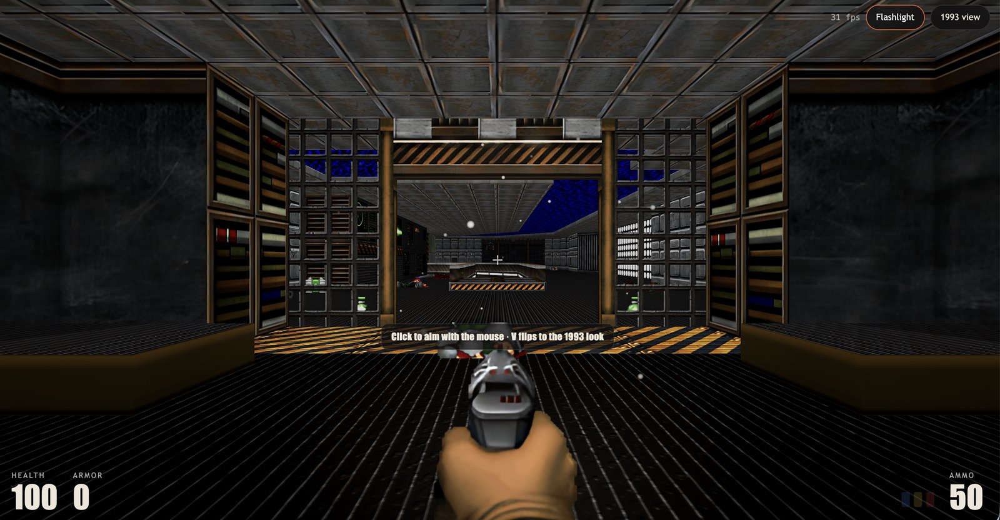

- **Real 3D, real light.** Rooms are rebuilt as true 3D geometry with dynamic lighting and shadows, instead of 1993's flat software-rendered columns.
- **Sharper textures.** The original low-res art is upscaled by a small AI model that runs locally in your browser.
- **Mouselook and a crosshair.** Look up and down freely. Shots still use Doom's original auto-aim, so the game plays fair to the original.
- **A flashlight.** Press **L** and dark corners stop being safe for anything.
- **Atmosphere.** Drifting dust and light effects give rooms depth.
- **A clean modern HUD.** Health, armor and ammo, out of your way.
- **The original game underneath.** The real Doom engine runs the simulation, so the game *plays* exactly like Doom. Only the picture changes.
- **The 1993 flip.** Press **V** and you're back to the original look, status bar and all:

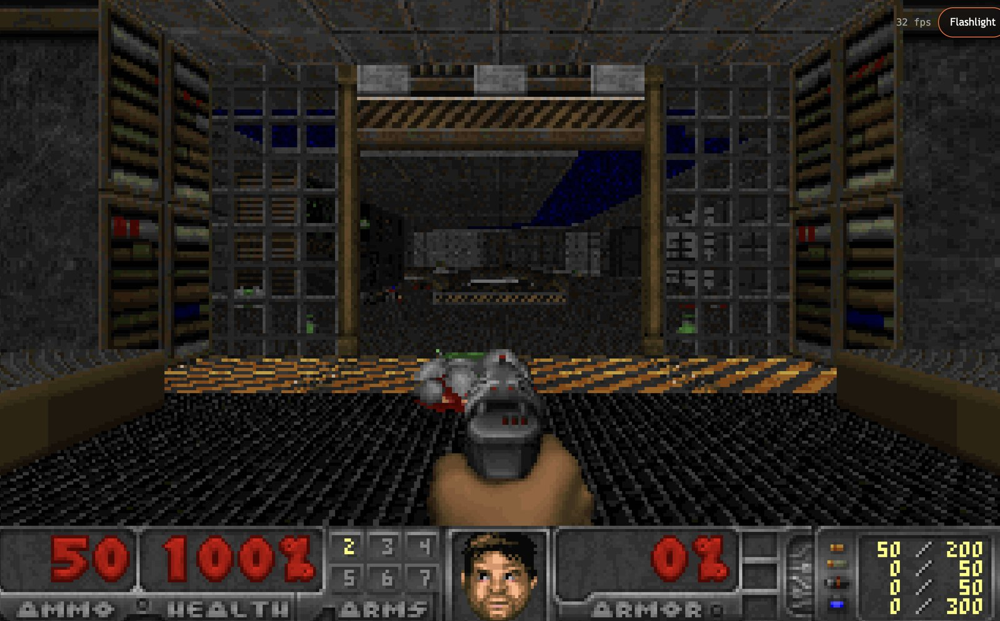

---

## Controls

| Key | Action |
|---|---|
| **W A S D** | Move |
| **Mouse** | Look and aim (click the game first) |
| **Click** | Fire |
| **Space** | Open doors, press switches |
| **1–7** | Switch weapon |
| **L** | Flashlight |
| **V** | Flip between 1993 and Relit |
| **Esc** | Menu, and frees the mouse |

In Wrecklight you drive instead; its keys are [listed below](#bonus-level-wrecklight-car-combat).

---

## What you can play

| Game file | Where to get it | Status |
|---|---|---|
| **Freedoom: Phase 1** (36 levels) | Included: `game/freedoom1.wad` | ✅ Ready to play |
| **Freedoom: Phase 2** (32 levels) | Included: `game/freedoom2.wad` | ✅ Ready to play |
| **Doom** (`doom.wad`) | Your own copy (Steam, GOG) | ✅ Tested |
| **Doom II** (`doom2.wad`) | Your own copy (Steam, GOG) | ✅ Tested |
| **Quake: Episode 1** (all 8 levels) | Built in; pick it on the start screen | ✅ Ready to play |
| **OpenArena: The Other Side** (bonus arena) | Built in; pick it on the start screen | ✅ Ready to play |
| **Wrecklight** (car combat) | Built in; pick it on the start screen | 🧪 New, still being tuned |

Own the original games? Pick your `doom.wad` or `doom2.wad` and play id Software's original levels with Relit's new look. Your file stays on your machine.

### Bonus episode: Quake Episode 1

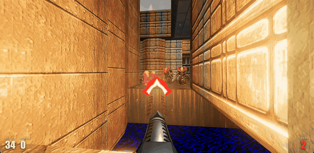

All eight levels of Quake's first episode, Dimension of the Doomed, rebuilt as Doom maps and played on Doom's original 1993 engine, with Doom's monsters, weapons and Freedoom's textures. Relit draws it with the same real-time lighting as every other level, so muzzle flashes and fireballs light up Quake's corridors.

| | |
|---|---|
| 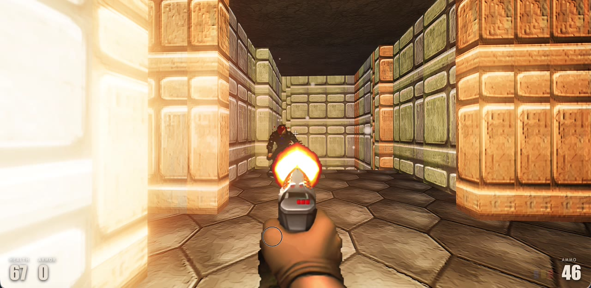 | 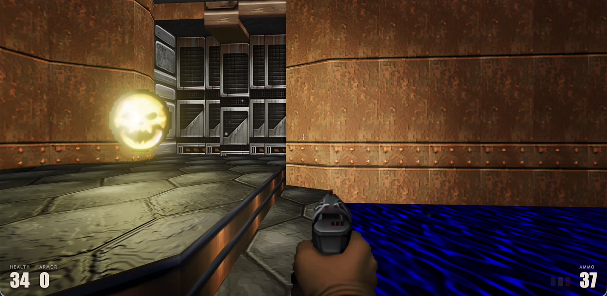 |

**The four levels:**

| | |
|---|---|
| 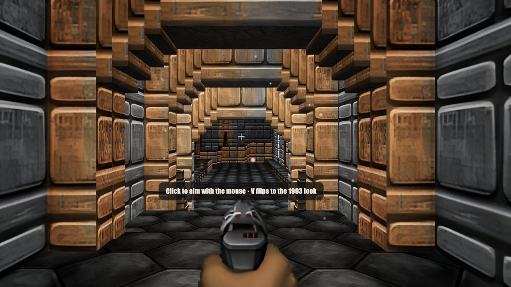<br>**1 · The Slipgate Complex** | 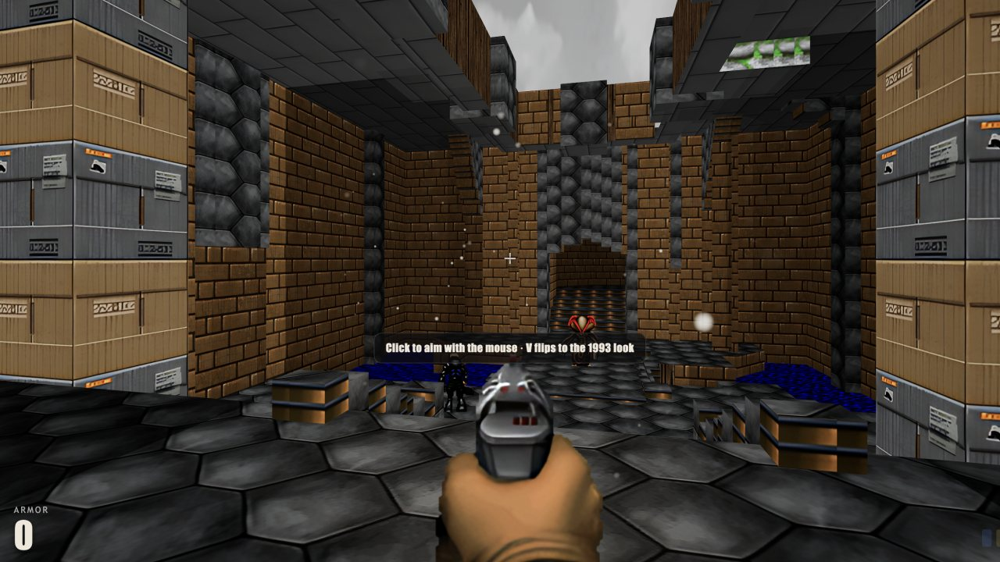<br>**2 · Castle of the Damned** |
| 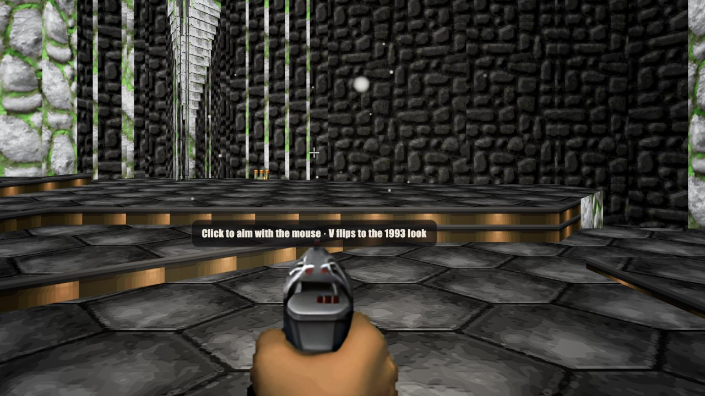<br>**3 · The Necropolis** | 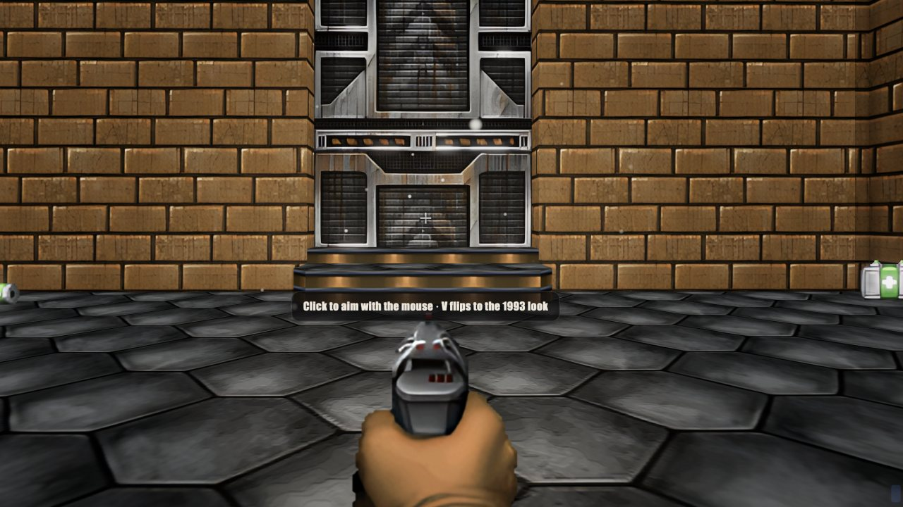<br>**4 · The Grisly Grotto** |

**All eight levels**, in the order Quake plays them (its secret level, Ziggurat Vertigo, comes after the Grisly Grotto, as in Quake):

1 · The Slipgate Complex · 2 · Castle of the Damned · 3 · The Necropolis · 4 · The Grisly Grotto · 5 · Ziggurat Vertigo · 6 · Gloom Keep · 7 · The Door to Chthon · 8 · The House of Chthon

Every level has its own upbeat track from the game file's soundtrack.

**How to play:** open `relit.html`, click **Quake: Episode 1**, pick a level (1 to 8) and press **Play**. Freedoom is built in, so there's no file to choose. Finishing a level leads into the next, and the House of Chthon ends the episode. Classic cheats work too: `IDDQD`, `IDKFA`, `IDCLEV12`.

**How it was made:**
- It starts from the original Quake map sources (`e1m1.map` to `e1m8.map`) that John Romero released under the **GPL in 2006**. Only the layout and object placement are used; no Quake art or sound is included.
- [`tools/quake2doom`](tools/quake2doom) converts Quake's 3D brushes into a Doom map: floors and ceilings, doors, lifts (including Quake's elevator), the exit, light levels from Quake's 190 lights, and monsters and items swapped for their Doom equivalents.
- Doom levels can't stack rooms, so where Quake has a room above another, the floor on the walking route is kept. Ramps become small steps, and water and slime become shallow pools.
- Every Quake teleporter keeps its own destination. Gloom Keep's moat is raised so you can step out where Quake players would swim and climb.
- Ziggurat Vertigo plays with normal gravity, and Chthon is a Cyberdemon in his lava pit: shoot him down instead of using Quake's electrode trap.
- The Necropolis and the Grisly Grotto are far bigger than any 1993 map, so Relit's engine reads map data as unsigned 16-bit numbers (as Boom-style ports do) and gives each level a 64 MB memory pool. The Slipgate runs at Freedoom's frame rate; the two big maps are heavier.

Details in [`maps/README.md`](maps/README.md). Works with Doom 1-style files such as `freedoom1.wad`.

### Bonus level: OpenArena, The Other Side

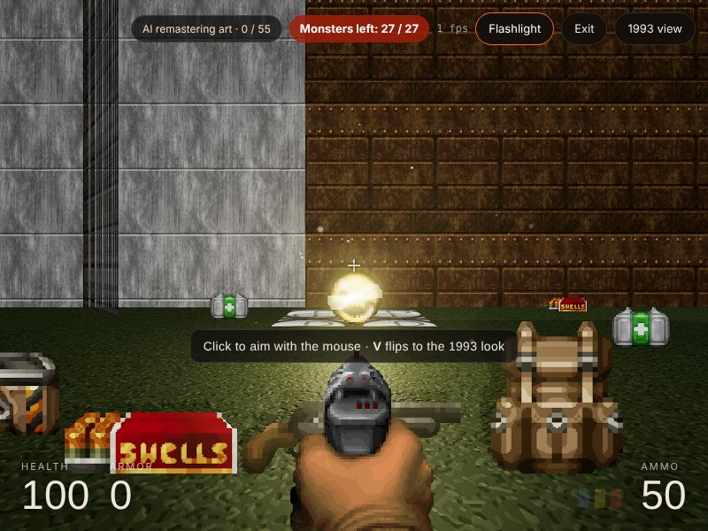

"The Other Side" (`oacmpdm5`), a Quake III-style deathmatch arena from OpenArena, rebuilt as a Doom II level and turned into a single-player fight. You face chaingunners, revenants, mancubi, arachnotrons and a few arch-viles: 17, 27 or 39 of them depending on difficulty. A super shotgun, a backpack and plenty of shells keep you fighting.

**How to play:** open `relit.html`, click **OpenArena: The Other Side** and press **Play**. It uses the built-in Freedoom: Phase 2, so there's no file to choose. A counter at the top shows how many monsters are left. Kill every mancubus to lower the exit pad at the north end. Silver pads launch you across the arena, and red pads teleport you.

How it was made:
- It starts from the map source by Jan Groothuijse in the OpenArena Community Mappack, released under the **GPL v2 or later**. Only the layout and item placement are used; no OpenArena art or sound is included.
- [`tools/quake2doom`](tools/quake2doom) now also reads Quake III `.map` files. Curved surfaces are flattened into small blocks. Where walkways are stacked, the lower one is kept and the upper one becomes a raised ledge.
- Jump pads and teleporters become Doom teleporters. The level sits in Doom II's MAP07 slot, so the exit opens when the last mancubus dies, as in the original game.

Works with Doom II-style files such as `freedoom2.wad` or `doom2.wad`.

---

### Bonus level: Wrecklight, car combat

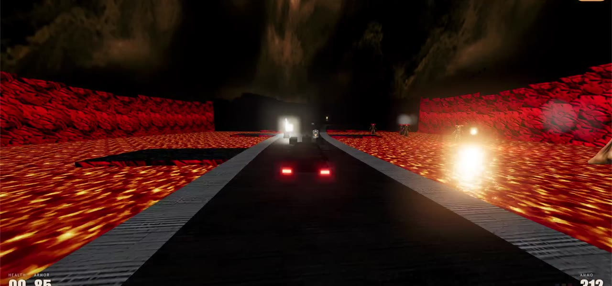

A night lap of Stunt Rally's volcanic "Dark" track, rebuilt as a Doom II level, driven in an armed car. Doom's monsters line the 1.4 km road. Ram them, shoot them, and wreck every mancubus to open the gate before the finish line.

**How to play:** open `relit.html`, click **Wrecklight: car combat**, pick a car and press **Play**. It uses the built-in Freedoom: Phase 2, so there's no file to choose. The bar at the top shows the mancubi left, your rockets and your speed.

| Car | What it is |
|---|---|
| **Ironhide** | Off-roader with a bull bar (Stunt Rally's LK4) |
| **Quicksilver** | Low race car with a rear wing (Stunt Rally's XZ) |
| **Old Thunder** | 1940s truck (Stunt Rally's OT) |
| **Rammer** | Relit's own blocky car |

Every car carries a roof gun, rocket pods and steel ram bars.

| Key | Action |
|---|---|
| **W** or **↑** | Gas |
| **S** or **↓** | Brake, then reverse |
| **A D** or **← →** | Steer (turns on the spot when stopped) |
| **Space** | Roof gun |
| **F** or **Shift** | Rockets |
| **Mouse** | Look around the car (click the game first) |
| **C** | Camera: close chase, far chase, driver's seat |
| **L** | Headlights |
| **R** | Back on the road |
| **V** | Flip between 1993 and Relit |

How it was made:
- The track is Stunt Rally 3's "Dark" (`vlc1-dark`), under the **GPL v3**. [`tools/stuntrally2doom`](tools/stuntrally2doom) turns its heightmap and road spline into Doom sectors: road, kerbs, roadside and cliff rims, with bridges raised over drops and low ground turned into lava.
- The three Stunt Rally cars are **CC0**, converted by [`tools/stuntrally-car`](tools/stuntrally-car). Relit adds the weapons and lamps.
- The engine gets a small car mode (`relit_car.c`): steering, grip, drag, ramming damage and rockets. The level sits in Doom II's MAP07 slot, so the gate opens when the last mancubus dies.

Still being tuned: handling and difficulty. Crossing the finish line currently carries on into Freedoom's level 8 on foot; a proper finish screen is coming.

Works with Doom II-style files such as `freedoom2.wad` or `doom2.wad`.

---

## How it works

```
your .wad file ──► Doom engine (C, compiled to WebAssembly) ──► game state
                                                                  │
                     Relit renderer (Three.js) ◄──────────────────┘
                     3D geometry · lighting · shadows · AI-upscaled textures
```

The engine is the original Doom source (via [doomgeneric](https://github.com/ozkl/doomgeneric), with Chocolate Doom's OPL music code) compiled to WebAssembly. Each frame, Relit reads the live game state, including map geometry, monsters, items and doors, and draws it in 3D. The engine never knows it's being drawn differently.

| File | What it is |
|---|---|
| `relit.html` | The whole game in one file: what players open |
| `remaster.js` | The 3D renderer |
| `effects.js`, `ai.js`, `relit-ai.bin` | Light effects, and the in-browser texture upscaler |
| `audio.js` | Sound and music |
| `main.js`, `index.html` | Start screen, level picker, HUD |
| `doom.wasm`, `engine-src/` | The Doom engine, compiled and as source |
| `tools/` | Build scripts, including `make-single.mjs`, which packs everything into `relit.html` |
| `game/` | Freedoom: Phase 1, with its licence |

### Building it yourself

```bash
npm install
npm run build              # writes dist/relit.html
cp dist/relit.html .       # the copy players open
```

To rebuild the engine (`doom.wasm`), run `npm run engine`. It compiles with Zig: `pip install ziglang` first.

---

## Share what you find

Played your own `doom2.wad` with it? Found a room that looks incredible with the flashlight? Post a screenshot in **Discussions**. And if the V flip made you smile, a ⭐ helps Relit find more players.

---

## Credits and licences

- **Doom engine** © id Software, released under the GPL. Ported to the browser via [doomgeneric](https://github.com/ozkl/doomgeneric).
- **Freedoom** by the [Freedoom project](https://freedoom.github.io), under a BSD licence (`game/FREEDOOM-LICENSE.txt`). Phase 1 and Phase 2 are both included.
- **OpenArena "The Other Side" (`oacmpdm5`)** by Jan Groothuijse, from the OpenArena Community Mappack Volume 1, under the GPL v2 or later; converted into `maps/arena.wad`. The source is in `maps/src/`. No OpenArena art or sound is included.
- **Stunt Rally 3 track "Dark" (`vlc1-dark`)** by Crystal Hammer and contributors, under the GPL v3; converted into `maps/wrecklight.wad`, which is GPL-3.0-or-later. The source is in `maps/src/vlc1-dark/`.
- **Stunt Rally 3 cars** LK4 (clarabox, CryHam), XZ (Neubi) and OT (irokrhus), all CC0; converted into `maps/cars/`. See `licenses/stuntrally-cars.txt`.
- **Quake E1M1–E1M4 map sources** by id Software, released by John Romero under the GPL (2006); converted into `maps/quake-e1.wad`. No Quake art or sound is included.
- **OPL music emulation** from DOSBox and Chocolate Doom (GPL-2.0-or-later).
- **Three.js** (MIT), **earcut** (ISC), **browser_wasi_shim** (MIT/Apache-2.0) and the **Real-ESRGAN** `realesr-general-x4v3` model weights (BSD-3-Clause). See `licenses/`.
- Relit is released under the **GPL-2.0-or-later** (see `LICENSE`).

Relit is a fan project and isn't affiliated with id Software, Bethesda or ZeniMax. *DOOM* is their trademark. The original game data is not included; bring your own copy to play it.

Made by [Shouvik Palit](https://x.com/shouvik_palit).
