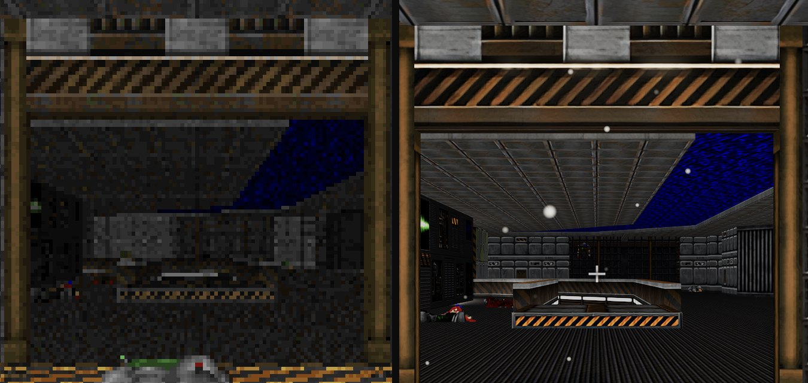
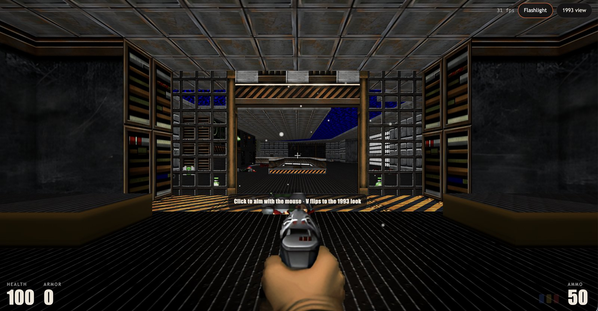
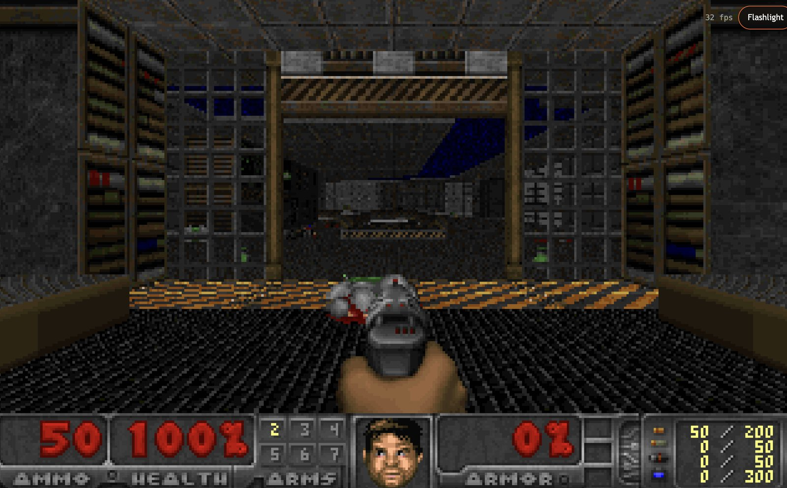
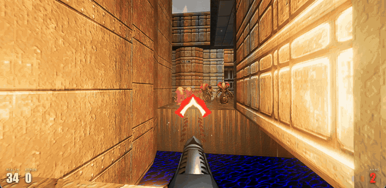
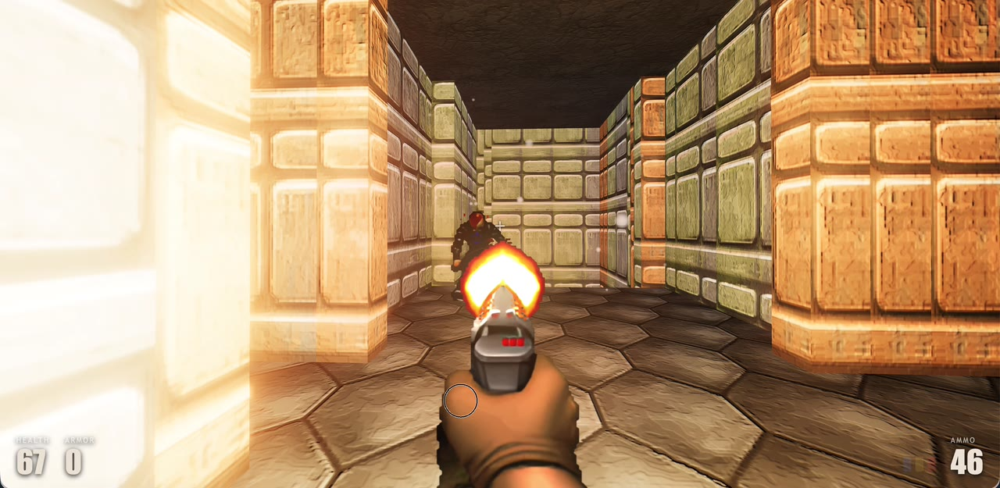
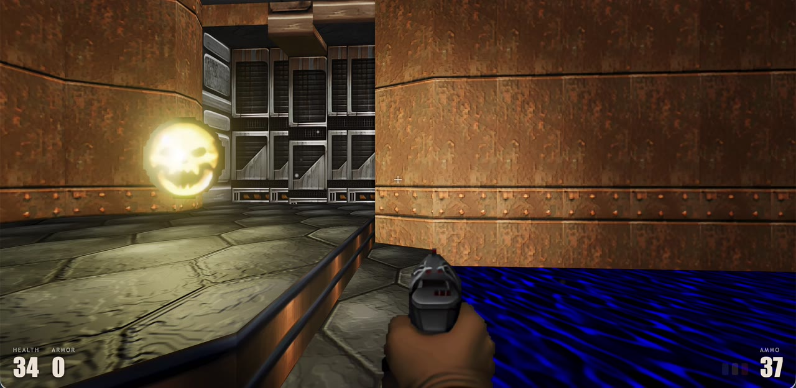
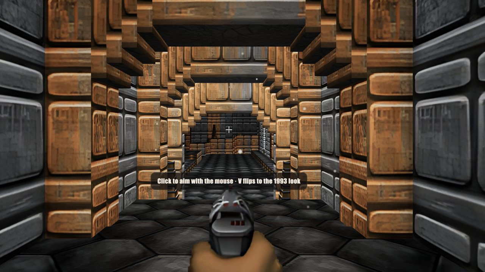
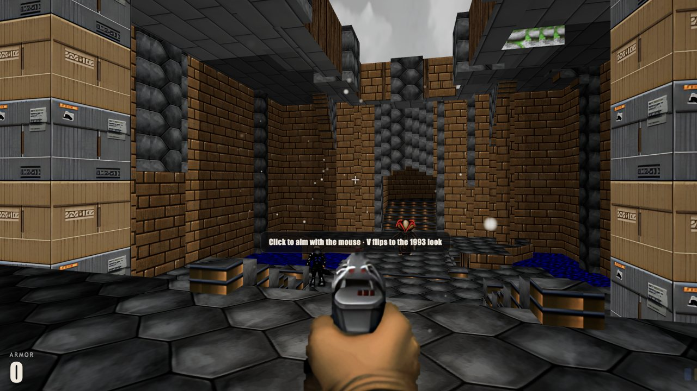
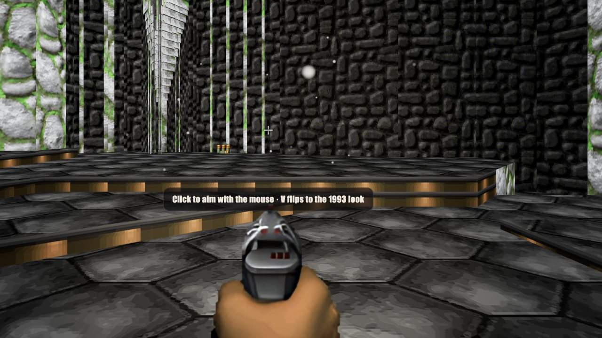
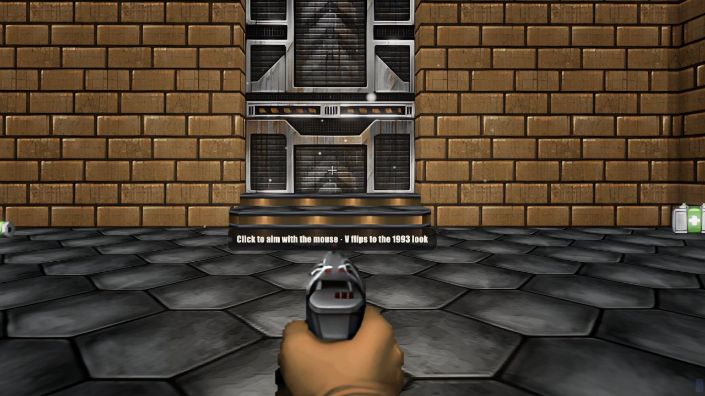

# Relit

**A new renderer for the original Doom engine.**

Relit keeps Doom's original engine running the game, every rule, monster and door exactly as it was, and replaces everything you *see* with a new real-time 3D renderer. Press **V** at any moment to flip between 1993 and now.



<p align="center"><sub>The same doorway, same moment, zoomed in. Left: the 1993 renderer. Right: Relit. One key flips between them.</sub></p>

> 🆕 **New: play all four levels of Quake's first episode on Doom's 1993 engine.** [See the Quake episode ↓](#bonus-episode-quake-episode-1)

---

## Play in 30 seconds

Everything you need is in this repo, including a free game to play.

1. **Get it:** `git clone https://github.com/shouvik12/relit.git`, or click **Code → Download ZIP** and unzip it.
2. **Open `relit.html`** with a double-click. It runs straight from your disk: no install, no server, no account.
3. **Pick a mode and press _Play_.** Choose the **Freedoom campaign** or **Quake: Episode 1** (then a level, 1 to 4). Freedoom is built in, so there's no file to find.

```
relit/
└── relit.html        ← double-click this, then press Play
```

Own the original Doom? Click **Use your own doom.wad** on the start screen, or drop the file onto the page.

> Works best in desktop **Chrome** or **Edge**. Nothing is uploaded anywhere; the game runs entirely on your computer.

---

## What Relit does



- **Real 3D, real light.** Rooms are rebuilt as true 3D geometry with dynamic lighting and shadows, instead of 1993's flat software-rendered columns.
- **Sharper textures.** The original low-res art is upscaled by a small AI model that runs locally in your browser.
- **Mouselook and a crosshair.** Look up and down freely. Shots still use Doom's original auto-aim, so the game plays fair to the original.
- **A flashlight.** Press **L** and dark corners stop being safe for anything.
- **Atmosphere.** Drifting dust and light effects give rooms depth.
- **A clean modern HUD.** Health, armor and ammo, out of your way.
- **The original game underneath.** The real Doom engine runs the simulation, so the game *plays* exactly like Doom. Only the picture changes.
- **The 1993 flip.** Press **V** and you're back to the original look, status bar and all:



---

## Controls

| Key | Action |
|---|---|
| **W A S D** | Move |
| **Mouse** | Look and aim (click the game first) |
| **Click** | Fire |
| **Space** | Open doors, press switches |
| **1–7** | Switch weapon |
| **L** | Flashlight |
| **V** | Flip between 1993 and Relit |
| **Esc** | Menu, and frees the mouse |

---

## What you can play

| Game file | Where to get it | Status |
|---|---|---|
| **Freedoom: Phase 1** (36 levels) | Included: `game/freedoom1.wad` | ✅ Ready to play |
| **Freedoom: Phase 2** (32 levels) | Free from [freedoom.github.io](https://freedoom.github.io/download.html) | ✅ Tested |
| **Doom** (`doom.wad`) | Your own copy (Steam, GOG) | ✅ Tested |
| **Doom II** (`doom2.wad`) | Your own copy (Steam, GOG) | ✅ Tested |
| **Quake: Episode 1** (4 bonus levels) | Built in; pick it on the start screen | ✅ Ready to play |

Own the original games? Pick your `doom.wad` or `doom2.wad` and play id Software's original levels with Relit's new look. Your file stays on your machine.

### Bonus episode: Quake Episode 1



The Slipgate Complex, Castle of the Damned, the Necropolis and the Grisly Grotto: Quake's first episode, rebuilt as Doom maps and played on Doom's original 1993 engine, with Doom's monsters, weapons and Freedoom's textures. Relit draws it with the same real-time lighting as every other level, so muzzle flashes and fireballs light up Quake's corridors.

| | |
|---|---|
|  |  |

**The four levels:**

| | |
|---|---|
| <br>**1 · The Slipgate Complex** | <br>**2 · Castle of the Damned** |
| <br>**3 · The Necropolis** | <br>**4 · The Grisly Grotto** |

**How to play:** open `relit.html`, click **Quake: Episode 1**, pick a level (1 to 4) and press **Play**. Freedoom is built in, so there's no file to choose. Finishing a level leads into the next. Classic cheats work too: `IDDQD`, `IDKFA`, `IDCLEV12`.

**How it was made:**
- It starts from the original Quake map source (`e1m1.map`) that John Romero released under the **GPL in 2006**. Only the layout and object placement are used; no Quake art or sound is included.
- [`tools/quake2doom`](tools/quake2doom) converts Quake's 3D brushes into a Doom map: floors and ceilings, doors, lifts (including Quake's elevator), the exit, light levels from Quake's 190 lights, and monsters and items swapped for their Doom equivalents.
- Doom levels can't stack rooms, so where Quake has a room above another, the floor on the walking route is kept. Ramps become small steps, and water and slime become shallow pools.
- It runs at full speed: the same frame rate as Freedoom's own levels.

Details in [`maps/README.md`](maps/README.md). Works with Doom 1-style files such as `freedoom1.wad`.

---

## How it works

```
your .wad file ──► Doom engine (C, compiled to WebAssembly) ──► game state
                                                                  │
                     Relit renderer (Three.js) ◄──────────────────┘
                     3D geometry · lighting · shadows · AI-upscaled textures
```

The engine is the original Doom source (via [doomgeneric](https://github.com/ozkl/doomgeneric), with Chocolate Doom's OPL music code) compiled to WebAssembly. Each frame, Relit reads the live game state, including map geometry, monsters, items and doors, and draws it in 3D. The engine never knows it's being drawn differently.

| File | What it is |
|---|---|
| `relit.html` | The whole game in one file: what players open |
| `remaster.js` | The 3D renderer |
| `effects.js`, `ai.js`, `relit-ai.bin` | Light effects, and the in-browser texture upscaler |
| `audio.js` | Sound and music |
| `main.js`, `index.html` | Start screen, file picker, HUD |
| `doom.wasm`, `engine-src/` | The Doom engine, compiled and as source |
| `tools/` | Build scripts, including `make-single.mjs`, which packs everything into `relit.html` |
| `game/` | Freedoom: Phase 1, with its licence |

### Building it yourself

```bash
npm install
npm run build              # writes dist/relit.html
cp dist/relit.html .       # the copy players open
```

To rebuild the engine (`doom.wasm`), run `npm run engine`. It compiles with Zig: `pip install ziglang` first.

---

## Share what you find

Played your own `doom2.wad` with it? Found a room that looks incredible with the flashlight? Post a screenshot in **Discussions**. And if the V flip made you smile, a ⭐ helps Relit find more players.

---

## Credits and licences

- **Doom engine** © id Software, released under the GPL. Ported to the browser via [doomgeneric](https://github.com/ozkl/doomgeneric).
- **Freedoom** by the [Freedoom project](https://freedoom.github.io), under a BSD licence (`game/FREEDOOM-LICENSE.txt`).
- **Quake E1M1 map source** by id Software, released by John Romero under the GPL (2006); converted into `maps/slipgate.wad`. No Quake art or sound is included.
- **OPL music emulation** from DOSBox and Chocolate Doom (GPL-2.0-or-later).
- **Three.js** (MIT), **earcut** (ISC), **browser_wasi_shim** (MIT/Apache-2.0) and the **Real-ESRGAN** `realesr-general-x4v3` model weights (BSD-3-Clause). See `licenses/`.
- Relit is released under the **GPL-2.0-or-later** (see `LICENSE`).

Relit is a fan project and isn't affiliated with id Software, Bethesda or ZeniMax. *DOOM* is their trademark. The original game data is not included; bring your own copy to play it.

Made by [Shouvik Palit](https://x.com/shouvik_palit).
